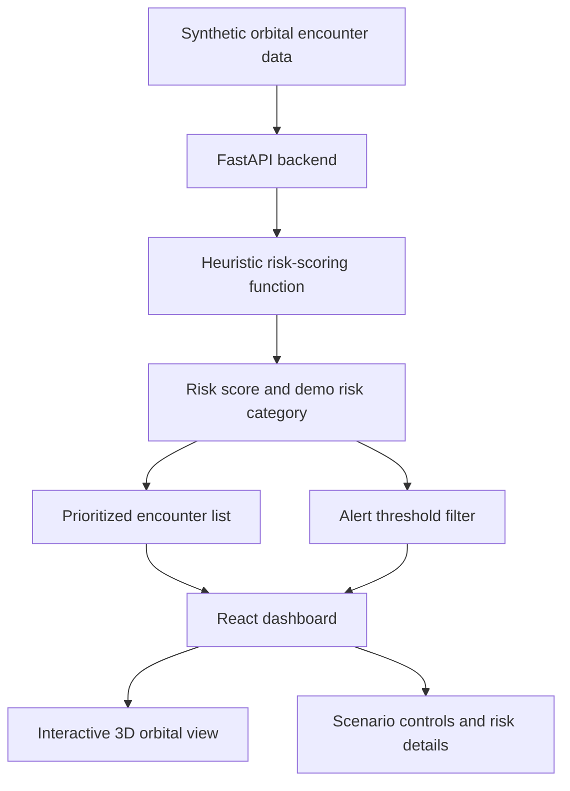
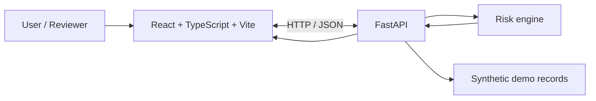

🛰️ SPACEGUARD

AI-Powered Space-Debris Collision Early-Warning System

IBM Datathon 2026 ·
*From tracking objects in orbit to understanding which encounters need
attention first.*
:::🌍 The mission
Earth's orbit is becoming more crowded with active satellites and space
debris. A high-speed collision can damage valuable spacecraft and create
additional fragments, making future collisions more likely. This
cascading risk is often discussed as Kessler Syndrome.
Traditional tracking views can show where objects are. SPACEGUARD
focuses on the next question:
Which satellite--debris encounters should be reviewed first, and
why?

SPACEGUARD is a full-stack prototype that turns sample orbital encounter
data into an easy-to-understand risk dashboard with a 3D orbital view,
prioritized encounters, and configurable alerts.
\(!IMPORTANT\) Prototype status: The current version uses
synthetic demonstration data and a transparent heuristic risk score.
It does not yet use a trained/validated AI model, live orbital data,
or operational collision probabilities. Do not use it to make real
spacecraft manoeuvre or collision-avoidance decisions.

✨ Explore the features
  Feature                 What it does            Why it matters
  🌐 3D orbital         Displays an animated    Makes orbital activity
  visualization         Earth, orbit paths, and easier to explore
                          object markers          visually
  🎯 Encounter          Ranks sample encounters Helps users focus on
  prioritization        using a demo risk index higher-scoring cases
                                                  first
  🚨 Alert threshold  Filters encounters that Demonstrates how an
                          exceed a configurable   early-warning workflow
                          score                   could work
  🧪 Scenario           Switches between low,   Lets reviewers see how
  simulator             elevated, and critical  the dashboard responds
                          demo conditions         to changing scenarios
  🧭 Risk               Shows encounter details Makes the result easier
  explanations          and factors used by the to interpret
                          demo scoring logic      
  🧑‍🚀 Beginner-friendly  Provides a login-style  Helps non-specialists
  experience            welcome screen and      understand the purpose
                          simple explanations     of the system
  🔌 REST API         Serves summary metrics, Separates the interface
                          encounters, alerts, and from backend logic
                      scenario changes        
🧠 How SPACEGUARD works

1. Load sample encounters --- the prototype starts with bundled
   demonstration records.
2. Evaluate the sample parameters --- the backend applies its
   current heuristic scoring logic.
3. Prioritize encounters --- the dashboard presents higher-scoring
   cases for review.
4. Check the alert threshold --- encounters meeting the selected
   threshold appear in the alert view.
5. Explore scenarios --- change the demo scenario to observe how
   the displayed results change.
🧰 Technology stack

<strong>{=html}Frontend</strong>{=html} --- click to expand

- React --- user interface components
- TypeScript --- typed frontend code
- Vite --- local development server and production build
- Three.js --- 3D graphics
- React Three Fiber --- React renderer for Three.js
- Drei --- helper components for React Three Fiber
- CSS --- dashboard layout and styling

<strong>{=html}Backend</strong>{=html} --- click to expand

- Python --- backend language
- FastAPI --- REST API and application logic
- Uvicorn --- ASGI server used to run the API
- pytest --- backend test framework
See frontend/package.json and backend/requirements.txt for the
project's dependency declarations.

<strong>{=html}Planned platform</strong>{=html} --- IBM LinuxONE

IBM LinuxONE is a planned deployment target, not a current
integration. Its enterprise-oriented security, resilience, and
scalability make it worth evaluating for hosting the API and future
data-processing services. Actual deployment requires access to an
environment, dependency compatibility checks, configuration, and
testing.
Deployment notes are in
[`linuxone/DEPLOYMENT.md`](linuxone/DEPLOYMENT.md).

🏗️ Architecture

The frontend and backend run as separate local processes. The UI
requests data from FastAPI, while the backend provides demo records,
scenario switching, and heuristic risk calculations.
🚀 Run it locally
Requirements
- Git
- Node.js and npm
- Python 3.10 or later
- VS Code (or another editor)
1. Get the code
git clone https://github.com/Lakshana907/SPACEGUARD.git
cd SPACEGUARD
Or download the ZIP from GitHub and extract it.
2. Start the backend
Open Terminal 1 in the project root.
Windows PowerShell
cd backend
py -m venv .venv
.\.venv\Scripts\Activate.ps1
pip install -r requirements.txt
uvicorn app.main:app --reload --port 8000
If PowerShell blocks activation, run this in the same terminal, then
retry activation:
Set-ExecutionPolicy -Scope Process Bypass
.\.venv\Scripts\Activate.ps1
Keep this terminal open.
3. Start the frontend
Open Terminal 2 at the project root:
cd frontend
npm install
npm run dev
Open the URL shown in the terminal, usually http://localhost:5173.
Terminal tip: If your terminal is already inside frontend, do
not run cd frontend again.

4. Check the backend
  Resource               Local URL
  API root               http://127.0.0.1:8000/
  Health check           http://127.0.0.1:8000/health
  Interactive API docs   http://127.0.0.1:8000/docs
5. Build and test
Frontend production build:
cd frontend
npm run build
Backend tests (from the project root, with the backend environment
activated):
cd backend
py -m pytest
If pytest is not installed, install it in the active environment with
py -m pip install pytest.
🔗 API reference
  Method                  Endpoint                     Purpose
  GET                   /                          API welcome/status
                                                       response
  GET                   /health                    Health check
  GET                   /api/summary               Dashboard summary
                                                       metrics
  GET                   /api/encounters            Sample encounter
                                                       records and risk
                                                       information
  GET                   /api/alerts?threshold=65   Alerts above the
                                                       requested threshold
  POST                  /api/scenarios/low         Load the low-risk demo
                                                       scenario
  POST                  /api/scenarios/elevated    Load the elevated-risk
                                                       demo scenario
  POST                  /api/scenarios/critical    Load the critical-risk
                                                   demo scenario
For exact request/response schemas, run the backend and open FastAPI
Swagger docs.
📊 Understanding the risk score
The current score is a demonstration index generated by heuristic
logic. It is used to order sample encounters and demonstrate
threshold-based alerts.
- It is not a calibrated collision probability.
- It is not an official space-traffic-management risk classification.
- Results depend on the sample data and current scoring rules.
- Real-world use would require validated orbital elements, trajectory
  propagation, closest-approach calculations, uncertainty analysis,
  independent evaluation, and domain-expert review.
🛰️ IBM LinuxONE: planned next step
SPACEGUARD is being developed with a potential LinuxONE deployment in
mind. The planned evaluation includes:
- Hosting the FastAPI backend on a Linux environment.
- Verifying Python dependencies and runtime compatibility.
- Configuring secure network access and environment settings.
- Testing API availability and frontend-to-backend connectivity.
- Evaluating operational monitoring and deployment automation.
No LinuxONE deployment or IBM service connection is claimed in this
repository today. See the deployment guide for the intended next
steps.
🗺️ Roadmap
- [ ] Connect to a trusted orbital-data source and show data
  provenance/freshness.
- [ ] Implement validated orbital propagation and closest-approach
  calculations.
- [ ] Evaluate a trained ML model only when suitable labelled data is
  available.
- [ ] Show uncertainty and explainability alongside scores.
- [ ] Replace the demo login gate with secure authentication and
  server-side authorization.
- [ ] Add integration tests, CI checks, logging, and monitoring.
- [ ] Deploy and test the backend on IBM LinuxONE, if access and
  environment requirements are met.
🔐 Security and responsible use
- The current login-style screen is a demo gate, not production
  authentication.
- Do not enter or commit real passwords, tokens, API keys, .env
  files, SSH private keys, or credentials.
- Do not treat prototype scores as real collision predictions.
- Review the repository contents before making it public.
📁 Repository layout
SPACEGUARD/
├── frontend/                 # React + TypeScript + 3D interface
├── backend/
│   ├── app/
│   │   ├── main.py           # FastAPI routes
│   │   ├── data.py           # Demo data
│   │   └── risk_engine.py    # Heuristic scoring logic
│   ├── tests/                # Backend tests
│   └── requirements.txt
├── linuxone/
│   └── DEPLOYMENT.md         # Planned LinuxONE deployment notes
├── .gitignore
└── README.md
🌱 Contributing
Ideas, bug reports, and improvements are welcome.
1. Create a feature branch.
2. Make a focused change.
3. Run the frontend build and backend tests.
4. Open a pull request describing the change and how it was tested.
📚 Open-source resources
- React
- TypeScript
- Vite
- Three.js
- React Three Fiber
- Drei
- Python
- FastAPI
- pytest
The current prototype uses simulated orbital data; external orbital data
services are not yet integrated.
📄 License
No license has been added yet. Until a license is included, reuse
permissions are not explicitly granted. Add a suitable license file
before inviting public reuse.
::: {align="center"}
**SPACEGUARD · IBM Datathon 2026 · `SSF2026`**

*Making orbital risk easier to see, understand, and prioritize.*
:::


