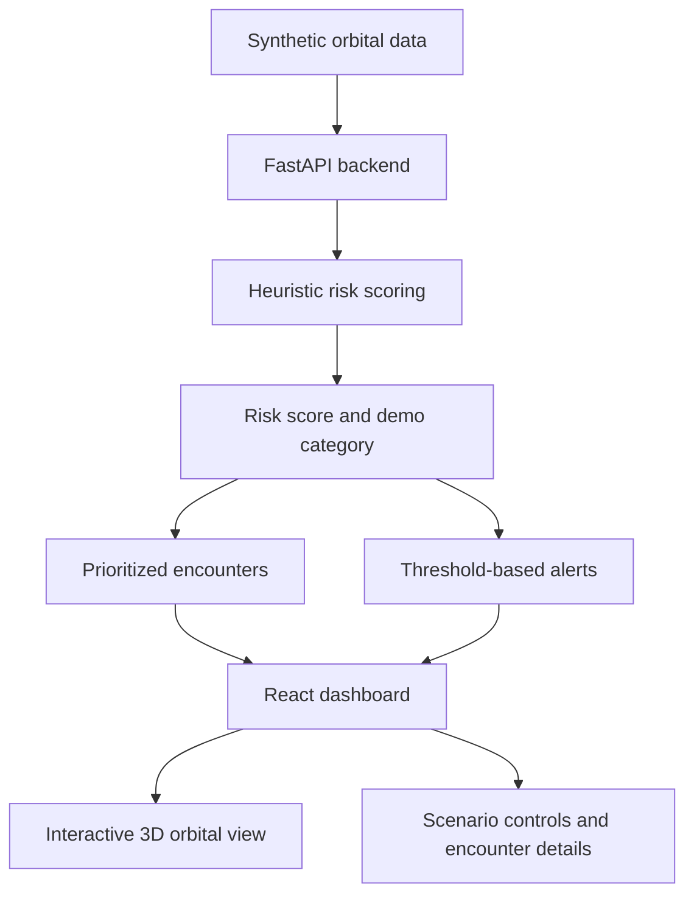

🛰️ SPACEGUARD
AI-Powered Space-Debris Collision Early-Warning System
IBM Datathon 2026 · Event Code: SSF2026

From tracking objects in orbit to understanding which encounters need
attention first.

🌍 Overview
Earth’s orbit is becoming more crowded with active satellites and space
debris. A high-speed collision can damage spacecraft and generate
additional fragments, increasing the risk of further collisions—a
cascading problem commonly associated with Kessler Syndrome.
SPACEGUARD is a full-stack prototype that demonstrates how orbital
encounter data can be turned into understandable risk information. It
combines a 3D orbital view, prioritized encounters, risk indicators, and
configurable alerts in one dashboard.
\(!IMPORTANT\) Prototype limitation: This version uses simulated
orbital data and a heuristic risk score. It does not yet use a trained
and validated AI model, live orbital data, or operational collision
probabilities. It must not be used to make real spacecraft manoeuvre
or collision-avoidance decisions.

🎯 The problem
Tracking systems help show where objects are, but users also need help
deciding which encounters deserve attention first. SPACEGUARD
demonstrates a workflow for prioritizing potentially dangerous
satellite–debris encounters and making risk information easier to
understand.
💡 How SPACEGUARD works
1. Load sample encounters from the bundled demonstration data.
2. Assess the sample parameters using the backend’s current
   heuristic scoring logic.
3. Prioritize encounters in the dashboard by their demonstration
   risk score.
4. Raise demo alerts when a score crosses the selected threshold.
5. Explore scenarios to see how low, elevated, and critical demo
   conditions change the dashboard.
✨ Key features
Feature	What you can do
🌐 Interactive 3D orbit	Explore an animated Earth, orbital paths, and object markers
🎯 Risk overview	Review summary indicators and prioritized sample encounters
🚨 Alert threshold	Adjust the threshold used to display alerts
🧪 Scenario controls	Switch between low, elevated, and critical demonstration scenarios
🔎 Risk details	Inspect encounter information and the factors used by the demo scoring logic
🧭 Beginner-friendly UI	Explore a welcome/login-style screen and simple explanations
🔌 REST API	Retrieve summary metrics, encounters, alerts, and scenario updates

🏗️ Architecture

🧰 Technology stack
Technology	Role in SPACEGUARD
React	Builds the frontend user interface
TypeScript	Adds types to frontend code
Vite	Runs the development server and builds the frontend
Three.js	Provides 3D graphics
React Three Fiber	Connects Three.js rendering with React
Drei	Provides helper components for React Three Fiber
CSS	Styles the dashboard
Python	Backend language
FastAPI	Provides REST endpoints and backend logic
Uvicorn	Runs the FastAPI application
pytest	Backend testing framework
IBM LinuxONE	Planned deployment platform; not currently integrated

For exact dependency versions, see
[`frontend/package.json`](frontend/package.json) and
[`backend/requirements.txt`](backend/requirements.txt).
🚀 Run locally
Requirements
- Git
- Node.js and npm
- Python 3.10 or later
- VS Code or another code editor
1. Clone the repository
git clone
cd SPACEGUARD
Alternatively, download the ZIP from GitHub and extract it.
2. Start the backend
Open a terminal at the project root.
Windows PowerShell:
cd backend
py -m venv .venv
.\.venv\Scripts\Activate.ps1
pip install -r requirements.txt
uvicorn app.main:app --reload --port 8000
If PowerShell blocks virtual-environment activation, run this in the
same terminal and try activation again:
Set-ExecutionPolicy -Scope Process Bypass
.\.venv\Scripts\Activate.ps1
Keep the backend terminal open.
3. Start the frontend
Open a second terminal at the project root:
cd frontend
npm install
npm run dev
Open the URL printed by Vite, usually <>.
If your terminal is already inside the frontend folder, do not run
cd frontend again.

4. Useful local URLs
Service	URL
Frontend	
Backend API	
Backend health check	
Interactive API documentation	

5. Build and test
Build the frontend from the project root:
cd frontend
npm run build
Run backend tests from the project root with the backend virtual
environment active:
cd backend
py -m pytest
If pytest is not installed, run py -m pip install pytest in the active
environment.
🔌 API endpoints
Method	Endpoint	Purpose
GET	/	API status response
GET	/health	Health check
GET	/api/summary	Dashboard summary metrics
GET	/api/encounters	Sample encounters and risk information
GET	/api/alerts?threshold=65	Alerts above the selected threshold
POST	/api/scenarios/low	Load the low-risk demo scenario
POST	/api/scenarios/elevated	Load the elevated-risk demo scenario
POST	/api/scenarios/critical	Load the critical-risk demo scenario

Start the backend and visit the interactive API
docs to inspect the available request and
response schemas.
📊 What does the risk score mean?
The current score is a demonstration index generated by heuristic
logic. It helps order sample encounters and demonstrate threshold-based
alerts.
- It is not a calibrated collision probability.
- The categories are not official space-traffic-management
  classifications.
- Results depend on the included sample data and current scoring rules.
- A real system would need validated orbital data, trajectory
  propagation, closest-approach calculations, uncertainty modelling,
  testing, and expert review.
🛰️ IBM LinuxONE integration
IBM LinuxONE is a planned deployment target. Its enterprise
security, resilience, and scalability make it a platform worth
evaluating for hosting the backend and future data-processing services.
Planned work: - Verify Python dependency and runtime compatibility. -
Deploy and test the FastAPI backend in an available LinuxONE
environment. - Configure secure network access and environment
variables. - Test frontend-to-backend connectivity and service
availability. - Evaluate monitoring and deployment automation.
This repository does not claim that SPACEGUARD is already deployed to
LinuxONE or connected to IBM services. See
[`linuxone/DEPLOYMENT.md`](linuxone/DEPLOYMENT.md) for deployment notes.
🗺️ Roadmap
- [ ] Integrate a trusted orbital-data source and display data
  freshness.
- [ ] Implement validated orbital propagation and closest-approach
  calculations.
- [ ] Evaluate a trained ML model when suitable labelled data is
  available.
- [ ] Display uncertainty and explanations alongside risk scores.
- [ ] Replace the demo login screen with secure authentication and
  server-side authorization.
- [ ] Add integration tests, CI checks, logging, and monitoring.
- [ ] Deploy and test on IBM LinuxONE if access and environment
  requirements are met.
🔐 Security and responsible use
- The login-style screen is a demo gate, not production authentication.
- Never commit passwords, API keys, .env files, SSH private keys, or
  credentials.
- Do not use prototype scores for real collision-avoidance decisions.
- Review files before making the repository public.
📁 Project structure
SPACEGUARD/
├── frontend/                 # React + TypeScript + 3D interface
├── backend/
│   ├── app/
│   │   ├── main.py           # FastAPI routes
│   │   ├── data.py           # Synthetic demonstration data
│   │   └── risk_engine.py    # Heuristic scoring logic
│   ├── tests/                # Backend tests
│   └── requirements.txt
├── linuxone/
│   └── DEPLOYMENT.md         # Planned deployment notes
├── .gitignore
└── README.md
🔗 Open-source resources
- React
- TypeScript
- Vite
- Three.js
- React Three Fiber
- Drei
- Python
- FastAPI
- pytest
No external orbital dataset is currently integrated; the prototype uses
simulated data.
🤝 Contributing
1. Create a feature branch.
2. Make a focused change.
3. Run the frontend build and backend tests.
4. Open a pull request describing the change and tests performed.
📄 License
A license has not yet been added. Until a license is included, reuse
permissions are not explicitly granted.

SPACEGUARD · IBM Datathon 2026 · SSF2026
Making orbital risk easier to see, understand, and prioritize.

